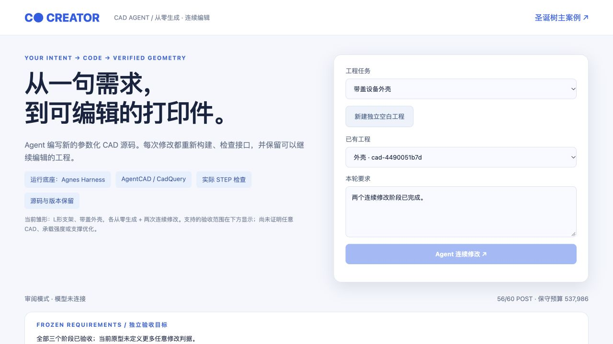
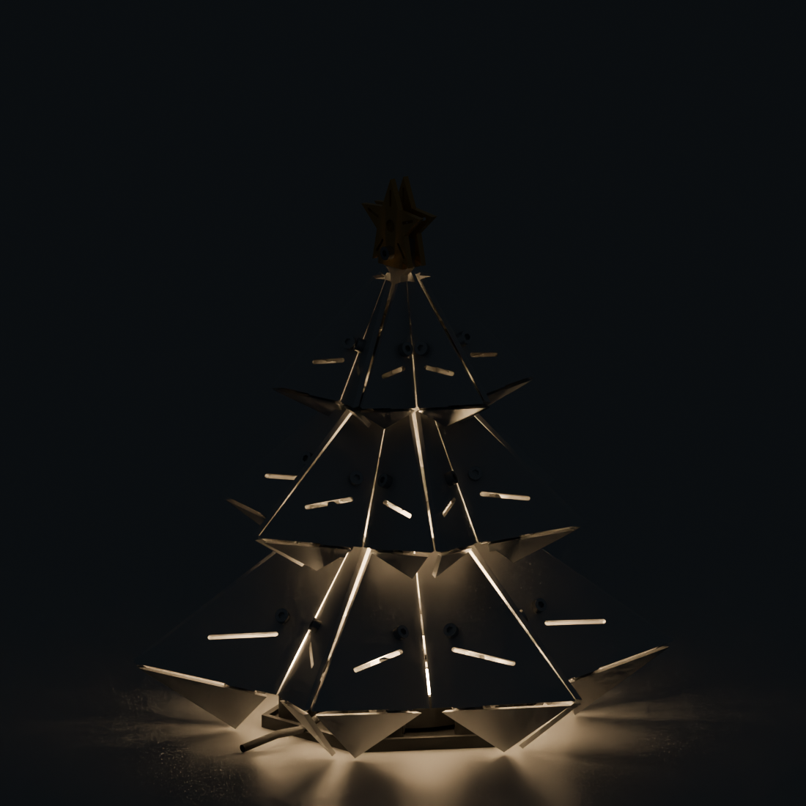
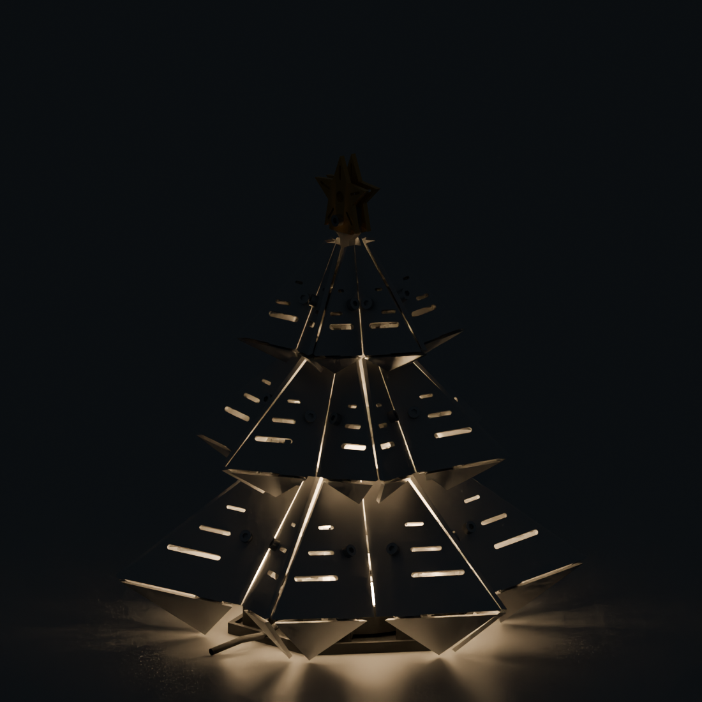
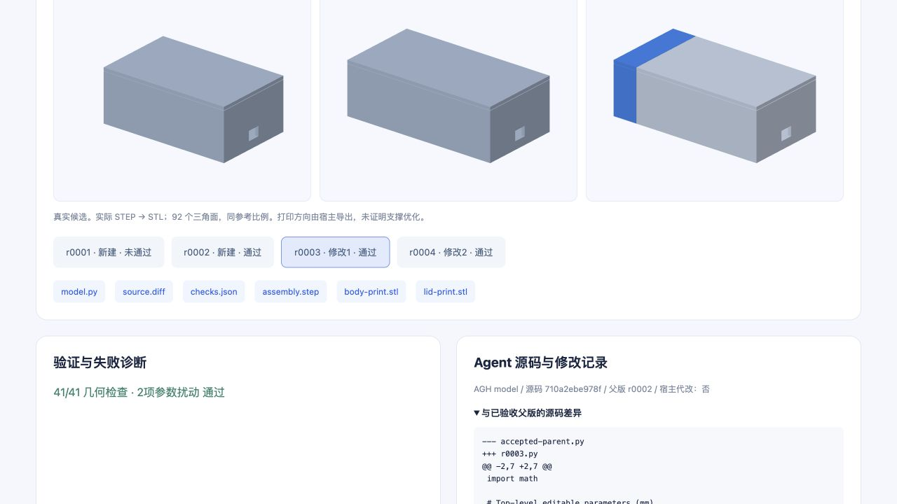

# CREATOR · 面向3D打印的参数化CAD Agent

2026江苏省AI+科学与工程创新实践黑客松（高校组），CREATOR / 本科生组 U274。项目公开记录日期：2026-10-15，实际平台时间以GitHub提交记录为准。

CREATOR把自然语言需求、CAD执行、独立几何验证、图片反馈和连续编辑连接起来，让设计保留可修改的参数、可检查的装配接口和可下载的工程产物。

## 已有真实打印成品

上图和[正面照片](images/tree-physical-front.jpg)由项目成员提供，是既有圣诞树灯的打印/装配/亮灯实物，作为V9主案例参考。本次Agent生成的渐变多光窗改型已完成CAD与仿真验证，尚未打印新实物；两者分别展示。

## AGH如何参与

`用户要求 → AGH内模型读取工程 → 写参数化源码/布局 → 工具执行 → 独立检查 → 失败诊断与实际图片 → 模型修正 → 保留版本并继续编辑`

- Agnes Harness提供智能体运行与工具调度。
- AgentCAD/CadQuery处理从零生成的支架、带盖外壳；FreeCAD处理V9既有工程的受控修改和零件复用。
- 独立STEP/BRep检查器验证尺寸、孔位、装配、实体与参数驱动；Blender Cycles做同条件灯效比较。
- 实际核心模型为用户兼容网关回报的`gpt-6-astra / high`；Codex辅助开发框架、算子、适配器和检查器。早期`agnes-3.0-flash`受控修改任务单独归档。

## 圣诞树主案例：从单槽到三层渐变光窗

复用既有V9工程，Agent决定三层开窗数量、长度和布局，在固定孔附近保留至少4.6mm材料，并保持铰链、固定接口和307装配实例。

实际CAD候选检查过程为`323/360 → 308/360 → 354/360 → 499/499`；字段拒绝和原失败版本保留。最终三层各3窗，最小孔净距4.953mm；37定义/307实例及其余31定义、接口保持。模型接收实际工具图片后分析结果。

| 原版单槽 · 同条件Cycles | Agent渐变光窗 · 同条件Cycles |
|---|---|
|  |  |

同灯源、材质、相机、曝光，256 samples。图像用于定性比较，几何面积变化不换算成亮度增益。

## 从零建模与连续编辑

| 任务 | 从零生成 | 修改1 | 修改2 |
|---|---|---|---|
| L形支架 | 25/25 | 长度60→75mm，26/26 | 三孔5→6mm，26/26 |
| 带盖设备盒 | 39/39 | 长度80→95mm，41/41 | 走线口8→12mm，41/41 |

每阶段另有两个参数的实际独立扰动重建，并检查显式零件ID、正确父版源码、模型源码与执行输入一致、模型收到实际工具图片。正式候选由AGH模型提供，宿主未替改答案。

精选可查看样例：

- [支架参数化源码](examples/bracket/model.py)、[STEP](examples/bracket/assembly.step)、[验证摘要](examples/bracket/validation-summary.json)
- [外壳参数化源码](examples/enclosure/model.py)、[STEP](examples/enclosure/assembly.step)、[验证摘要](examples/enclosure/validation-summary.json)

源码使用CadQuery和AgentCAD的`show_object`接口。完整工作台源码、安装/复现说明和原始执行轨迹由赛事作品包提供。本仓库提供公开项目记录、精选实际样例与演示。

## 演示视频

- [GitHub视频副本](media/creator-demo.mp4)
- [百度网盘视频主链接](https://pan.baidu.com/s/1VGypgvxgHLx1V3BBApsQpA?pwd=bme5)，提取码`bme5`，永久有效。
- 视频208秒（3分28秒）、1920×1080，最后8秒为既有真实打印实物照片。

视频以真实操作为主，标明实时任务、已验收历史回看和追加失败；原始运行与失败记录保留。既有实物照片与新数字候选分开标注。

## 来源与当前范围

[Agnes Harness](https://github.com/AgnesAI-Labs/agnes-harness)、[AgentCAD](https://github.com/jdilla1277/agentcad)（固定提交`2a377583d9d250971a584acb7b5ac6e2a75737c0`，Apache-2.0）、CadQuery、FreeCAD、Blender及本人既有V9工程。

当前通用入口为两个任务族的可验证雏形，尚未证明任意CAD可靠性、25%少支撑优化或新改型的实物强度/温升/光学测量。旧打印样例和旧切片与新CAD改型分别记录。
